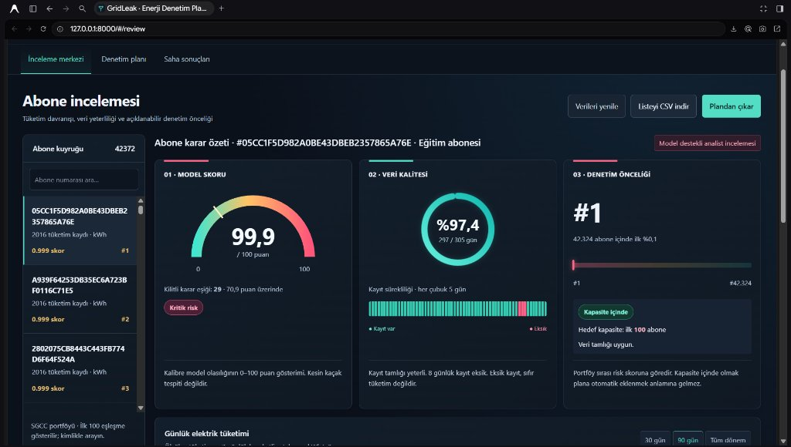
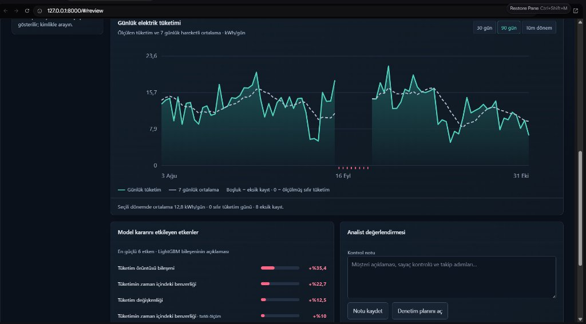
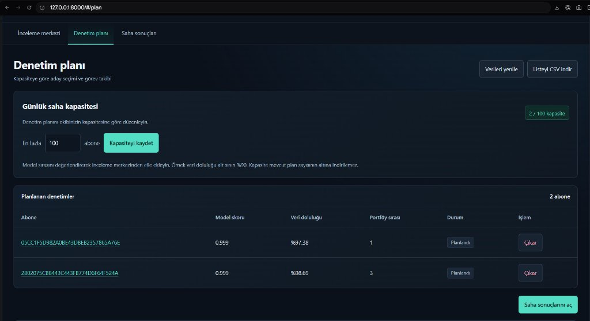
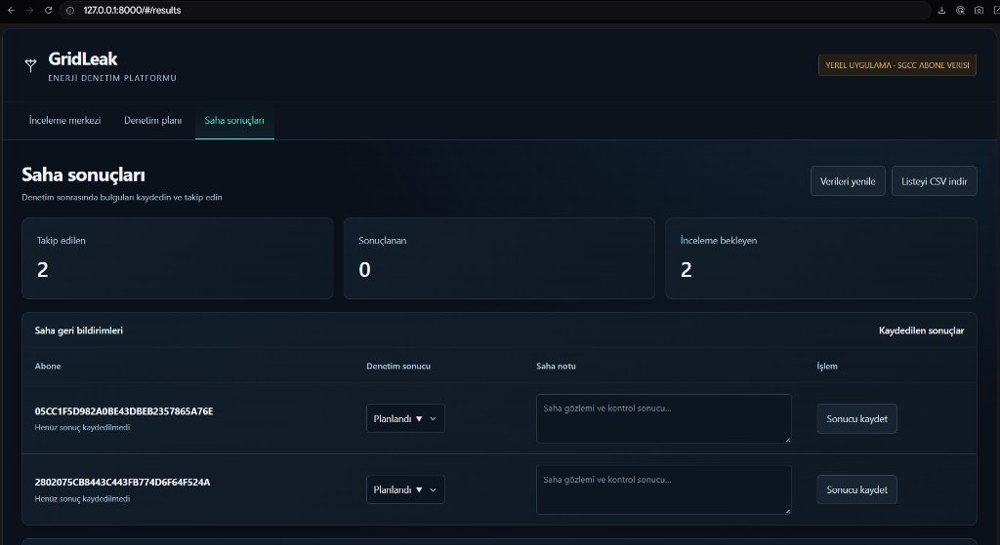

<div align="center">

# ⚡ GridLeak AI — Akıllı Şebeke Elektrik Kaçağı Tespit ve Saha Denetim Platformu

**Makine öğrenmesi destekli kalibre risk puanlama, açıklanabilir yapay zeka (TreeSHAP) ve saha denetim karar destek sistemi.**

[](https://hub.docker.com/r/kadirdyn/gridleak-ai)
[](https://www.python.org/)
[](https://fastapi.tiangolo.com/)
[](https://react.dev/)
[](#do%C4%9Frulama-ve-testler)

*42.372 akıllı sayaç abonesi · %100 İlk-50 Saha İsabeti (`P@50`) · AP `0,6157` (+%101,5) · ROC-AUC `0,9012`*

</div>

---

## 🎯 Proje Amacı ve Gerçek Hayat Problemi

Elektrik dağıtım şirketleri her gün on binlerce abonenin sayaç verisini toplar ancak sahaya gönderebilecekleri denetim ekibi kapasitesi sınırlıdır (örneğin günde **20–100 abone**).

* **Rastgele denetim yapıldığında:** Kaçak oranı `%8,54` olduğu için gidilen her 100 kapının yaklaşık **91'i boş çıkar**; ekip zamanı ve operasyon maliyeti boşa gider.
* **GridLeak AI ile:** Sistem **42.372 aboneyi** çok yıllık (`2014–2016`) günlük tüketim örüntüleri, eksik ölçüm davranışları ve şebeke komşu sapmaları üzerinden kalibre risk puanına (`0–100`) göre sıralar. Kilitli test setinde en riskli ilk **50 abonenin 50'si de (%100)**, ilk **100 abonenin 92'si (%92)** gerçek kaçak olarak doğrulanmıştır.
* **Açıklanabilirlik (XAI):** Saha analistine yalnızca *"riskli"* demek yerine, her abonenin günlük tüketim grafiğini, veri tamlığını ve **kararı etkileyen en güçlü etkenleri** anlaşılır Türkçe oranlarla sunar.

---

## 🖥️ Uygulama Ekran Görüntüleri

### 1. İnceleme Merkezi — Kalibre Risk Puanı, Veri Kalitesi ve Denetim Önceliği
Abone kuyruğundan seçilen her abonenin **0–100 kalibre risk göstergesi** (kilitli karar eşiği `29,0` işaretli), **kayıt sürekliliği şeridi** ve **42.324 abonelik portföydeki sıra konumu** tek bakışta izlenir.



### 2. Günlük Elektrik Tüketimi & Model Kararını Etkileyen Etkenler (XAI)
Ölçülen günlük tüketim + 7 günlük hareketli ortalama grafiği eksik kayıtları sıfıra dönüştürmeden gösterir. Alt panelde LightGBM TreeSHAP katkıları saha dostu **Türkçe etken başlıkları ve göreli yüzde oranlarıyla** (`+%35,4`, `+%22,7` vb.) sunulur; yanında kalıcı **Analist değerlendirmesi** not alanı yer alır.



### 3. Denetim Planı — Saha Kapasitesi ve Aday Yönetimi
Günlük saha ekip kapasitesi belirlenir, inceleme merkezinden onaylanan aboneler denetim listesine alınır ve tek tıkla CSV olarak dışa aktarılabilir.



### 4. Saha Sonuçları — Denetim Geri Bildirim Döngüsü
Sahadan dönen ekipler kontrol bulgularını (*Planlandı, İnceleme sürüyor, Kaçak doğrulandı, Kaçak bulunmadı, Ek inceleme gerekli*) ve saha notlarını kalıcı SQLite veritabanına kaydeder.



---

## 🚀 Docker ile Tek Komutta Kurulumsuz Çalıştırma

Bilgisayarında yalnızca **Docker Desktop** olması yeterlidir — Python, Node.js, kütüphane veya veri kurulumu gerekmez:

```bash
docker run -d --name gridleak-ai -p 8000:8000 -v gridleak_storage:/app/backend/storage kadirdyn/gridleak-ai:latest
```

Ardından tarayıcıda **http://localhost:8000** adresini açın.

> **Docker Compose ile çalıştırmak isterseniz:**
> ```bash
> docker compose -f docker/docker-compose.yml up -d
> ```
> **Yerel Windows kurulumu için:** Proje kökündeki `START.cmd` dosyasına çift tıklayabilir veya [CALISTIRMA.md](CALISTIRMA.md) rehberini izleyebilirsiniz.

---

## 📈 Makine Öğrenmesi Gelişim Yolculuğu (v1 → v2 → v3)

Veri seti: **SGCC (State Grid Corporation of China)** — `42.372` abone, `1.034` gün (`2014–2016`), `%8,54` kaçak (`3.615` pozitif), `%91,46` normal (`38.757` negatif).

| Aşama | Özellik Mühendisliği | Model Mimarisi | Kilitli Test AP | ROC-AUC | Yanlış Alarm (FP) |
| :--- | :--- | :--- | :---: | :---: | :---: |
| **Başlangıç Fikri** | 7 ham özet istatistik (ort., std, min, maks, sıfır/eksik oranı) | Tekil temel sınıflandırıcılar | — | — | — |
| **v1 (Taban)** | **49** temel 2016 zaman serisi özelliği | Tekil LightGBM / RF | `0,2730` | `~0,810` | Yüksek |
| **v2 (Dalga 2)** | **239** özellik (+190 mevsimsel/haftalık/düşüş) | XGBoost + LGBM | `0,3055` | `0,842` | `1.623` |
| **v3 (Final)** | **581 aday → OOF budama ile 160 en güçlü özellik**<br>*(+198 çok yıllık 2014–2016 YoY + 144 kat-içi şebeke/SVD)* | **4-Aile Kalibre Stacking**<br>*(LightGBM + CatBoost + XGBoost + RankGauss MLP)* | **`0,6157`** *(+%101,5)* | **`0,9012`** | **`313`** *(-%80,7)* |

### Kilitli Test Seti Operasyonel Metrikleri (`8.466` Abone · `718` Gerçek Kaçak)

| Eşik Kademesi | Karar Eşiği | Precision | Recall | F1 | Doğru Kaçak (TP) | Yanlış Alarm (FP) |
| :--- | :---: | :---: | :---: | :---: | :---: | :---: |
| **Kritik Havuz (`P70`)** | `≥ 0,4029` | `%67,24` | `%48,61` | `0,5643` | `349` | `170` |
| **Birincil Eşik (`F1-Opt`, Aktif)** | `≥ 0,2901` | `%56,10` | `%55,71` | **`0,5590`** | **`400`** | **`313`** |
| **Geniş Havuz (`P50`)** | `≥ 0,1921` | `%46,66` | `%66,16` | `0,5472` | `475` | `543` |

* **Saha Önceliklendirme İsabeti (`Precision@K`):** `P@20 = %100 (20/20)` · `P@50 = %100 (50/50)` · `P@100 = %92,0 (92/100)` · `P@250 = %85,6 (214/250)` · `P@500 = %68,6 (343/500)`
* **Olasılık Kalibrasyonu:** Bağımsız 5-Katlı OOF `ECE = 0,0032`, Kilitli Test `ECE = 0,0087` (Sigmoid/Platt kalibrasyon).

### 🧪 Dengesiz Veri ve SMOTE Deneyi (Neden Denedik, Neden Kullanmadık?)
Sınıf dengesizliğini (`1:10,7`) bilimsel olarak test etmek için CV katları **içerisinde** (sıfır veri sızıntısıyla) **SMOTE (`sampling_strategy=0.5`)** 3 farklı model ailesinde sınandı:

| Model (160 Özellik · 3-Katlı OOF) | Doğal Dağılım AP | SMOTE (0.5) AP | Doğal FP | SMOTE FP | Sonuç |
| :--- | :---: | :---: | :---: | :---: | :--- |
| **LightGBM** | **`0,6142`** | `0,6048` | `1.167` | `1.069` | Doğal dağılım AP ve F1'de önde |
| **XGBoost** | **`0,6058`** | `0,5754` | **`1.066`** | `1.510` *(+444 FP)* | SMOTE yanlış alarmları ciddi artırdı |
| **Logistic Regression** | **`0,4125`** | `0,3921` | `2.190` | `1.728` | Doğal dağılım daha yüksek AP & ROC-AUC |

> **Karar:** 160 boyutlu zaman serisinde yapay SMOTE noktaları gürültü ürettiği ve olasılık kalibrasyonunu bozduğu için final modelde **doğal dağılım + kat içi kalibrasyon + kilitli eşik optimizasyonu** seçilmiştir.

---

## 🗂️ Proje Klasör Yapısı

```text
GridLeakAI/
├── ai/
│   ├── features/         # v3_features.py — Dalga 2, 2014–2016 YoY ve kat-içi bağlam/SVD özellikleri
│   ├── training/         # v3_final_train_and_test.py — 5-fold OOF, 4-aile kalibre Stacking eğitimi
│   ├── evaluation/       # v3_export_and_shap.py & export_application.py — TreeSHAP & SQLite katalog
│   ├── artifacts/        # Kilitli final v3 model çıktıları (Git dışı)
│   └── notebooks/        # Açıklamalı Jupyter Notebook'lar (EDA, v3 tam akış, SMOTE & SHAP)
├── assets/
│   └── screenshots/      # Web uygulaması ekran görüntüleri
├── backend/              # FastAPI API servisi, salt-okunur katalog okuyucu ve 7 otomatik test
├── docker/               # Dockerfile, Dockerfile.dockerignore ve docker-compose.yml
├── frontend/             # React 19 + TypeScript + Vite saha denetim arayüzü
├── data/                 # Ham SGCC verisi ve uygulama SQLite kataloğu (Git dışı)
├── reports/              # Model iyileştirme günlüğü ve entegrasyon sonuçları
├── START.cmd             # Tek tıkla yerel başlatıcı (Windows)
├── CALISTIRMA.md         # Detaylı yerel kurulum ve geliştirme notları
└── requirements.txt      # AI geliştirme ortamı paket listesi
```

---

## 🔒 Veri Sızıntısı Önlemleri ve Güvenlik

* **Sıfır Etiket Sızıntısı:** Canlı uygulama kataloğu (`catalog.sqlite3`) ve tüm API uç noktaları kesinlikle `FLAG` etiketini içermez (otomatik testle doğrulanır).
* **Kat-İçi Dönüşümler:** Şebeke ortalamaları, SVD bileşenleri, `RankGauss` ölçekleme ve SMOTE deneyi istisnasız her CV eğitim katı içinde fit edilmiştir.
* **Tek Seferlik Kilitli Test:** `%20` test bölümü (`8.475` abone) model seçimi ve eşik kilitlemesi bitene kadar hiç açılmamıştır.

---

## ✅ Doğrulama ve Testler

```bash
# Backend + canlı katalog API testleri (7/7 geçer)
python -m pytest backend/test_api.py backend/test_live_catalog.py -v

# Frontend tip kontrolü ve üretim derlemesi
cd frontend && npm run build
```
